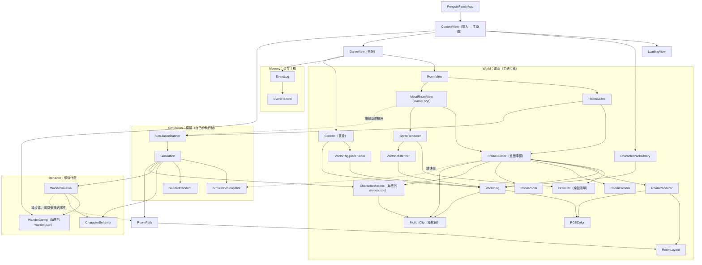
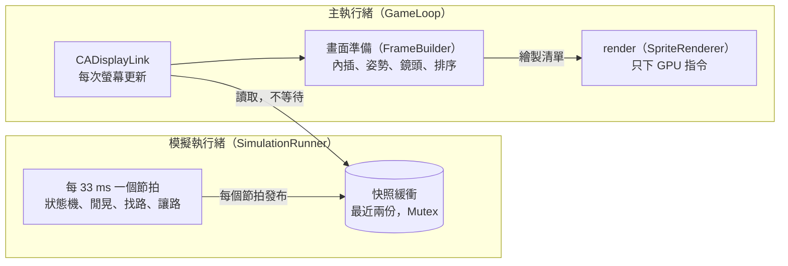
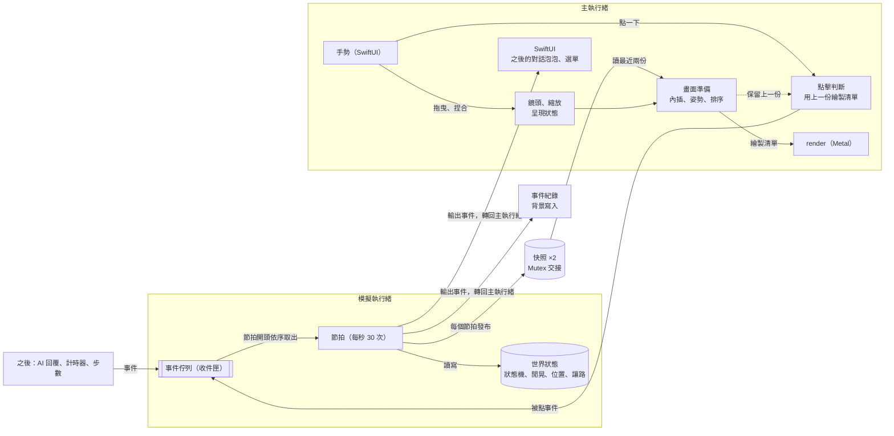
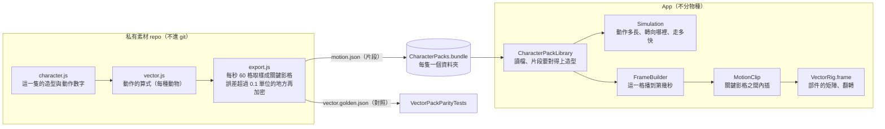
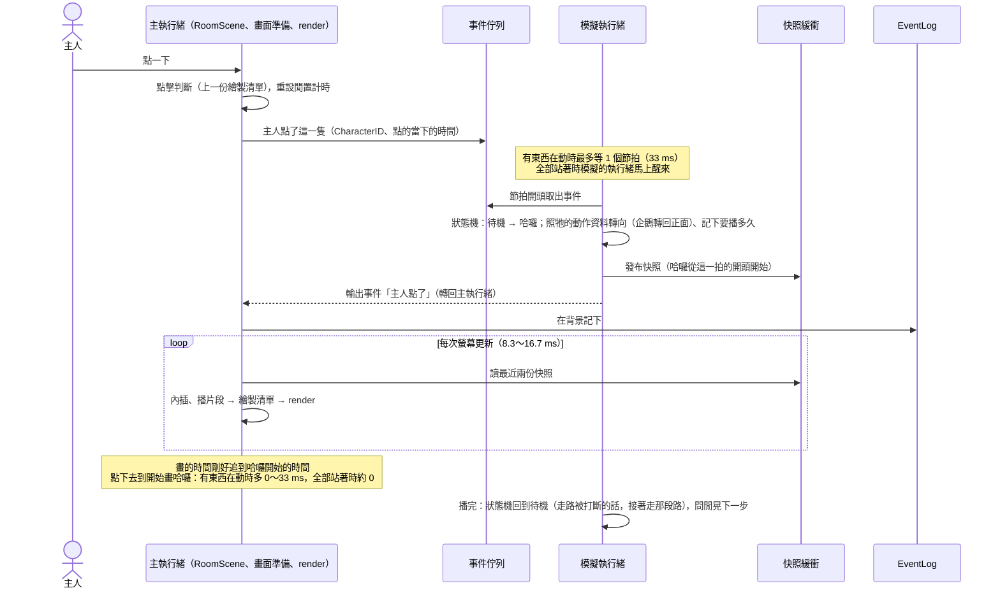

# 程式地圖

寫給作者與 Claude：快速看懂 App 目前長什麼樣子。只列**已經存在**的程式；規劃中的架構與模組在最後兩節。

- **為什麼這樣切**（模組邊界、設計原則、向量做法）看[架構](architecture.md)；這份只回答「有什麼、在哪裡、怎麼串起來」。
- **每個檔案的細節**寫在檔案開頭的 `///` 註解，這裡一個檔案只寫一句，避免兩邊寫同樣的事、改了一邊忘了另一邊。
- **保持同步**：`CodeMapTests` 會檢查每個 `.swift` 檔都列在這份文件裡、這裡列的檔案都存在；新增、刪除或改名檔案時，測試失敗就是提醒你回來更新。內容寫得對不對，還是靠人（作者 2026-11-16 決定）。
- 圖用 [Mermaid](https://docs.github.com/en/get-started/writing-on-github/working-with-advanced-formatting/creating-diagrams)：在 GitHub 上會畫成圖；在終端機裡看到的是原始文字。

最後更新：2026-11-23（v0.0.10：坐著打瞌睡與睏意；片段可以換部件、動作可以循環、共用特效，ADR 0010）。

## 一句話看懂

App 分四塊，資料只往一個方向流（ADR 0008）：

- **`Behavior`** 決定角色「想做什麼」，輸出意圖（待機、哈囉、走去某一格、站著幾秒）；沒人碰時由閒晃照資料挑下一步。純 Swift，不碰畫面，不分物種。
- **`Simulation`** 是唯一的世界狀態：持有每隻的狀態機與閒晃，照意圖移動、讓路、播動作，每秒 30 個節拍，在自己的執行緒上跑，交出快照。像 Vue 的 store：只有它能改狀態，別人只讀。
- **`World`** 把快照畫出來，並把主人的手勢交給模擬（點擊）或鏡頭（拖曳、捏合）。只有這層碰畫面（SwiftUI 與 Metal）。
  - `FrameBuilder`（畫面準備）拿模擬最近兩份快照內插、照每隻的動作片段算出這一格的樣子、交出繪製清單；`SpriteRenderer` 只照清單畫；`GameLoop` 跟著螢幕的節奏、清單變了才畫。
- **`Memory`** 記下發生過的事，只存在手機上。
- **`GameView`** 是外殼：把一家的資料交給箱庭（`RoomScene`，缺角色包的先換成替身），把模擬交出的點擊交給事件紀錄。像 Vue 的頁面元件。
- **`ContentView`** 先顯示載入畫面，在背景把角色準備好，再切到 `GameView`（見[架構的技術取捨](architecture.md#技術取捨)）。

## 檔案

### App 外殼

| 檔案 | 職責 |
|---|---|
| [PenguinFamilyApp.swift](../ios/PenguinFamily/PenguinFamilyApp.swift) | App 進入點：開事件紀錄的資料庫（打不開就改用暫存，角色照樣能用），放上 `ContentView`。 |
| [ContentView.swift](../ios/PenguinFamily/ContentView.swift) | 先顯示載入畫面，在背景做初始化（照名單載入一家、打開事件紀錄、讀閒晃的資料與共用特效的形狀），完成後淡入主遊戲。新增的初始化放在這裡的 `load()`。 |
| [LoadingView.swift](../ios/PenguinFamily/LoadingView.swift) | 載入畫面：和箱庭外面同一個底色，三個小方塊輪流亮。暫時的樣子。 |
| [GameView.swift](../ios/PenguinFamily/GameView.swift) | 主遊戲的外殼：把一家每一隻的身分、造型、動作與閒晃交給箱庭（缺角色包的換成替身），決定誰一開始在台上、站在箱庭的哪個起點（幾隻都可以）；模擬交出「主人點了哪一隻」時丟給事件紀錄在背景寫入。不持有狀態機。 |

### World：畫面

| 檔案 | 職責 |
|---|---|
| [CharacterPackLibrary.swift](../ios/PenguinFamily/World/CharacterPackLibrary.swift) | 照名單（`family.json`：誰、順序、物種）載入一家，幾隻由名單決定；每隻讀自己的 `vector.json`、`motion.json`（片段要對得上造型）、`wander.json`，沒帶或壞掉的那一份是 nil。名單上有、角色包沒有的照樣在（替身）；沒有名單時是預設的一家（兩隻企鵝的位置）。不寫死角色 id。 |
| [CharacterID.swift](../ios/PenguinFamily/World/CharacterID.swift) | 一隻角色的身分（名單上的 id；沒有名單時沒填到的是 `placeholder-<第幾隻>`），與物種 `Species`（企鵝、鯊魚等，名稱是資料）。模擬、畫面準備、點擊、事件紀錄都用身分認是哪一隻。 |
| [StandIn.swift](../ios/PenguinFamily/World/StandIn.swift) | 名單上每一隻實際用的造型與動作：缺角色包的借同物種那隻的形狀塗灰、動作也用牠的；同物種都沒有時用灰色剪影；動作資料沒帶時只會移動、不動手腳。 |
| [Facing.swift](../ios/PenguinFamily/World/Facing.swift) | 面向：正面與沿格線走的斜向四個方向，不分物種；名稱和角色包、閒晃資料用的相同。 |
| [EffectLibrary.swift](../ios/PenguinFamily/World/EffectLibrary.swift) | 不分物種的共用特效的形狀（ADR 0010：Z、鼻涕泡泡、泡泡破掉的線），讀 App 裡的 `effects.json`；怎麼動是每隻動作片段裡的特效軌道。 |
| [RGBColor.swift](../ios/PenguinFamily/World/RGBColor.swift) | 不透明的 sRGB 顏色，解析 `#RRGGBB`；角色包的顏色層、箱庭的色塊都用它。 |

**`World/Motion/`：角色怎麼動（動作是資料，App 只放播放器，ADR 0009）**

| 檔案 | 職責 |
|---|---|
| [CharacterMotions.swift](../ios/PenguinFamily/World/Motion/CharacterMotions.swift) | 一隻角色的動作資料（角色包的 `motion.json` 第 3 版，私有素材 repo 從算式取樣匯出）：動作（長度或循環長度、轉向哪裡、每個方向一段片段；寫了 `cycle` 的一直循環，例如打瞌睡）與慢、快兩種步態（一秒走幾格、循環長度、每個斜向一段片段）；讀檔（第 2 版也讀得懂）、檢查、片段對不對得上造型；沒有動作資料時的 `still`。 |
| [MotionClip.swift](../ios/PenguinFamily/World/Motion/MotionClip.swift) | 播放器：片段（每個部件一條關鍵影格的軌道；ADR 0010 加上部件什麼時候顯示、共用特效的軌道與透明度）在第幾秒的樣子，一次性的停在兩端、循環的接回開頭，關鍵影格之間直線內插，顯示不內插；部件的樣子 `PartPose`（以轉軸縮放、旋轉，再位移）、特效的樣子 `EffectPose`，與一隻角色這一格的樣子 `CharacterPose`（部件、顯示或藏起來、看得到的特效）。 |

**`World/Vector/`：角色的造型（ADR 0007）**

| 檔案 | 職責 |
|---|---|
| [VectorRig.swift](../ios/PenguinFamily/World/Vector/VectorRig.swift) | `vector.json` 的資料格式與檢查（部件的形狀、轉軸、顏色層、外框；平常藏起來的部件、不描共用外框的部件（ADR 0010）；右邊翻轉左邊；不要求特定部件，不分物種）；`Affine2D` 矩陣；某一格的樣子 `CharacterPose` 換成每個部件的矩陣（翻轉的方向用來源的姿勢再翻）、這一格要畫哪些部件、特效放到畫布上的矩陣（翻轉的方向只翻位置）；身體中央在腳底上方多高（鏡頭用）。 |
| [VectorRasterizer.swift](../ios/PenguinFamily/World/Vector/VectorRasterizer.swift) | 載入時用 Core Graphics 把每個畫好的方向的每個部件畫成兩張貼圖（外框、顏色；外形是空的部件只有顏色），共用特效也畫成一張，解析度照抱抱近景的倍率準備（螢幕倍率最多算到 2）；裁切每一組取聯集、組與組取交集；不用畫就能算出貼圖佔多少記憶體。 |
| [PlaceholderRig.swift](../ios/PenguinFamily/World/Vector/PlaceholderRig.swift) | 沒有角色包時的造型：替身（`graySilhouette()`，借同物種的形狀整隻塗灰）；同物種都沒有角色包時的灰色剪影（`VectorRig.placeholder`：只有正面，手藏在身體裡）與它的動作（`CharacterMotions.placeholder`：程式裡寫好的幾個關鍵影格，哈囉時手轉出來揮）。 |

**`World/Room/`：箱庭怎麼畫**

| 檔案 | 職責 |
|---|---|
| [RoomPath.swift](../ios/PenguinFamily/World/Room/RoomPath.swift) | 找路：哪些格子站得上去、沿格線一格一格走、繞過家具（需要時也避開別隻站的格子）；先挑最短、再挑轉彎最少，拆成一段段直線（每段對到斜向的一張圖）。閒晃用的：走到每一格要幾步、家具與窗戶旁邊站哪一格、某一格（別隻）四周站哪一格、面向哪裡（`RoomSpot`）。一開始站的格子：先用箱庭的起點，不夠時往外找最近的空格。 |
| [RoomLayout.swift](../ios/PenguinFamily/World/Room/RoomLayout.swift) | 房間的邏輯：幾格大、家具佔哪些格與多高、牆上有什麼、一開始站的起點、擺放檢查。也包含 `IsoProjection`：格子座標換算成等角的位置（單位，不取整數）。 |
| [RoomRenderer.swift](../ios/PenguinFamily/World/Room/RoomRenderer.swift) | 把牆、地板、窗戶與家具的色塊盒子做成凸多邊形（家具外面一圈外框）；決定誰畫在前面。 |
| [RoomCamera.swift](../ios/PenguinFamily/World/Room/RoomCamera.swift) | 鏡頭的數學：畫面中央對著哪一點、不超出房間、慢慢靠近目標。 |
| [RoomZoom.swift](../ios/PenguinFamily/World/Room/RoomZoom.swift) | 縮放的數學：最大 3pt、最小房間左右塞滿畫面、放開後停在那個倍率、手指下那一點不動。 |
| [RoomScene.swift](../ios/PenguinFamily/World/Room/RoomScene.swift) | 一個箱庭在 App 裡的東西：模擬與它的驅動、畫面準備，只建一次；點到角色時把「主人點了這一隻」送進模擬。後台名單的一隻（`Member`）由一家換好替身組成。 |
| [RoomView.swift](../ios/PenguinFamily/World/Room/RoomView.swift) | 放上 Metal 畫面，把點擊交給箱庭、拖曳與捏合交給畫面準備；箱庭在第一次出現時才建，之後沿用。Debug 編譯時右下角有「加睏意」按鈕（除錯用）。 |

**`World/Frame/`：畫面準備（ADR 0008）**

| 檔案 | 職責 |
|---|---|
| [FrameBuilder.swift](../ios/PenguinFamily/World/Frame/FrameBuilder.swift) | 每次螢幕更新拿模擬最近兩份快照內插：每隻的位置、這一格的樣子（照牠的動作資料找這個方向的片段，播到走了幾秒或「畫的時間 − 開始的時間」；藏起來的部件不畫，看得到的特效緊接在那隻後面）、前後順序（角色在家具旁邊時依格子關係），交出繪製清單；鏡頭（對準第一隻的身體中央）、縮放、拖曳、捏合、閒置後鏡頭回到第一隻；點到哪一隻。不改世界狀態，不分物種。 |
| [DrawList.swift](../ios/PenguinFamily/World/Frame/DrawList.swift) | 繪製清單：這一格由遠到近要畫的多邊形、角色部件（每個部件一個換到畫面 pt 的矩陣）與共用特效（矩陣與透明度）。可以比較，和上一格一樣就不重畫。 |

**`World/Render/`：用 Metal 畫出來**

| 檔案 | 職責 |
|---|---|
| [MetalRoomView.swift](../ios/PenguinFamily/World/Render/MetalRoomView.swift) | 把 Metal 畫面放進 SwiftUI；`GameLoop` 跟著螢幕更新（最高到手機支援的更新率）：讀模擬最新的快照（不等它）、準備畫面，繪製清單變了才畫，沒事時暫停；畫面出現時開模擬的執行緒、拆掉時停下；把模擬的輸出事件交出去。 |
| [SpriteRenderer.swift](../ios/PenguinFamily/World/Render/SpriteRenderer.swift) | 載入時把箱庭的多邊形切成三角形、角色的部件畫成貼圖（含 mipmap）；每一格只照繪製清單畫：多邊形、角色（先畫整隻的外框再畫顏色，貼圖的四個角照清單裡的矩陣放；右前、右後翻轉左邊的貼圖）、共用特效（乘上透明度）。不算姿勢、不排序。4 倍多重取樣抗鋸齒。shader 在同資料夾的 `Sprites.metal`。 |
| [PerfSignposts.swift](../ios/PenguinFamily/World/Render/PerfSignposts.swift) | 量效能用的標記（signpost）：遊戲迴圈每一格、畫面準備、畫、等畫布、點擊，與模擬的執行緒每次推進各花多久，在 Instruments 的 Points of Interest 看。 |

### Behavior：角色想做什麼

| 檔案 | 職責 |
|---|---|
| [CharacterBehavior.swift](../ios/PenguinFamily/Behavior/CharacterBehavior.swift) | 狀態機（不分物種）：待機 →（被點）→ 哈囉 →（播完）→ 待機；待機 →（要牠走去某一格，慢或快）→ 移動 →（走到）→ 待機；待機 →（要牠站幾秒）→ 站著 →（站滿）→ 待機，站著時被點就哈囉；移動中被點當場停下哈囉，記下那段路，播完接著走；待機 →（要牠打瞌睡）→ 坐下 → 打瞌睡（循環）→（睏意降下來）→ 自己醒來 → 待機，坐下或打瞌睡時被點就驚醒揉眼睛。哈囉、自己醒來、驚醒時再點會被忽略。同樣的意圖連續要兩次也算兩次改變。只輸出意圖（與意圖要播的動作名稱），不管動作播多久、怎麼走過去。 |
| [Sleepiness.swift](../ios/PenguinFamily/Behavior/Sleepiness.swift) | 一隻角色的睏意（0～100）：某個時間點是多少、每秒變多少，要用時再算現在的值；改速度、一下子加、還要幾秒降到某個值。 |
| [WanderConfig.swift](../ios/PenguinFamily/Behavior/WanderConfig.swift) | 閒晃的資料格式與檢查（每種活動的權重、冷卻、待多久；慢與快的比例；走幾步停一下；東張西望看哪些方向；第 3 版的睏意：開始的範圍、每分鐘增加多少、打瞌睡的門檻、機率（越睏越高）、下降速度、醒來的值與冷卻），讀 App 裡的預設 `wander.json`（每隻自己的在角色包裡）。第 1、2 版也讀得懂。 |
| [WanderRoutine.swift](../ios/PenguinFamily/Behavior/WanderRoutine.swift) | 閒晃：依權重挑活動、冷卻中的先不挑，拆成「走去某一格」「站著幾秒」一步步交給狀態機（走到家具旁邊面向它、隨便走走、發呆、東張西望、走去黏著另一隻，路長時走幾步停一下）；別隻的格子不當目的地；挑新的活動前，睏意夠高、冷卻好了就照機率改成打瞌睡。亂數、時間、別隻在哪與睏意由外面給。 |

### Simulation：世界怎麼變化（ADR 0008）

模擬在自己的執行緒上跑（`SimulationRunner`），主執行緒只讀最新的快照，從不等它。

| 檔案 | 職責 |
|---|---|
| [Simulation.swift](../ios/PenguinFamily/Simulation/Simulation.swift) | 唯一的世界狀態：台上每一隻的位置、面向、狀態機、閒晃、睏意、移動與讓路。動作多長、轉向哪裡、走多快看每隻的動作資料（沒有那個動作時馬上算播完；循環的動作不會播完）。睏意照在做什麼增減，打瞌睡時算好什麼時候醒（等打瞌睡播完一個循環）。固定節拍每秒 30 次；事件排進佇列、節拍開頭依序處理；回報播完、走到並交給狀態機，回到待機就問閒晃；交出快照與輸出事件；沒東西在動時可以直接跳過節拍。 |
| [SimulationSnapshot.swift](../ios/PenguinFamily/Simulation/SimulationSnapshot.swift) | 每個節拍交出的快照：台上每一隻在哪、面向哪、在做什麼（站著、播動作從什麼時候開始、移動走了幾秒），還要不要跑、何時醒來。不含畫面的東西。 |
| [SimulationRunner.swift](../ios/PenguinFamily/Simulation/SimulationRunner.swift) | 驅動模擬：開一條執行緒照真實時間跑節拍；沒東西在動時跳過、睡到排定的時間或有事件進來，落後太多時丟掉時間；用 `Mutex` 交接事件與最近兩份快照，輸出事件依序轉回主執行緒、樣子變了叫醒遊戲迴圈；畫的時間晚一個節拍。驗收用的啟動參數讓每個節拍故意變慢。 |
| [SeededRandom.swift](../ios/PenguinFamily/Simulation/SeededRandom.swift) | 固定種子的亂數（SplitMix64），讓模擬的結果固定。 |

### Memory：發生過什麼

| 檔案 | 職責 |
|---|---|
| [EventRecord.swift](../ios/PenguinFamily/Memory/EventRecord.swift) | 一筆事件的資料格式：什麼時候、什麼事、哪一隻。事件種類存字串，之後新增種類不用搬資料。 |
| [EventLog.swift](../ios/PenguinFamily/Memory/EventLog.swift) | 在背景寫入的事件紀錄（`ModelActor`）：開資料庫（關閉 iCloud 同步）、預熱、寫入事件、讀最近幾筆。一律用 `open(_:)` 在背景建立。 |

### 資源

- `Resources/wander.json`（進 git）：預設的閒晃資料（含睏意），給沒有角色包、或角色包沒帶自己閒晃資料的那隻；格式寫在 `WanderConfig` 的開頭。
- `Resources/effects.json`（進 git）：共用特效的形狀（Z、泡泡、泡泡破掉的線，ADR 0010）；格式寫在 `EffectLibrary` 的開頭。
- `Resources/CharacterPacks.bundle/`（不進 git，由私有素材 repo 匯出）：`family.json`（名單：誰、順序、物種）與每隻一個資料夾 `<角色>/`，裡面是 `vector.json`（造型）、`motion.json`（動作的片段）、`wander.json`（閒晃）。乾淨 clone 下來沒有，App 用預設的一家：兩個灰色剪影、預設的閒晃。

### 測試

| 檔案 | 測什麼 |
|---|---|
| [VectorPackParityTests.swift](../ios/PenguinFamilyTests/VectorPackParityTests.swift) | 拿真實角色包比對：App 照那隻自己的 `motion.json` 播（和畫面準備相同的找法），哈囉、斜向四個方向的慢與快、坐下、打瞌睡、自己醒來、驚醒揉眼睛，每個關鍵影格上每個部件的矩陣、要畫哪些部件、每個特效的矩陣與透明度和 `vector.js` 的算式相同，兩格中間不超過容許的差；沒有角色包時自動跳過。 |
| [CharacterDisplayTests.swift](../ios/PenguinFamilyTests/CharacterDisplayTests.swift) | 每隻帶自己的動作與閒晃（沒帶、壞掉或對不上造型時是 nil）、顏色、找角色包、名單（幾隻、順序、物種；第 1 版；名單壞掉時用預設的一家）、灰色剪影只有正面。 |
| [DozeTests.swift](../ios/PenguinFamilyTests/DozeTests.swift) | 打瞌睡：睏意的增減與上下限、狀態機（坐下、打瞌睡、自己醒來、被點驚醒）、閒晃照睏意與機率決定（越睏機率越高）、醒來後的冷卻、睏意資料的檢查；模擬裡從坐下到醒來、等循環結束才醒（醒來時略低於 `wakeBelow`）、只有打瞌睡的循環在降、被點驚醒、走路時睏得快、沒有打瞌睡的動作不打瞌睡、除錯的加睏意。 |
| [EffectLibraryTests.swift](../ios/PenguinFamilyTests/EffectLibraryTests.swift) | 共用特效：App 裡的 `effects.json` 有打瞌睡用到的特效、每個都畫得出來；壞掉的資料擋下來。 |
| [CharacterBehaviorTests.swift](../ios/PenguinFamilyTests/CharacterBehaviorTests.swift) | 狀態機的轉換（含移動中被點：哈囉完接著走）、同樣的意圖連續兩次。 |
| [MotionClipTests.swift](../ios/PenguinFamilyTests/MotionClipTests.swift) | 播放器：關鍵影格上的值、之間內插（角度走近的那邊）、一次性停在兩端、循環接回開頭；`motion.json` 的讀檔與檢查、片段對不對得上造型；沒有動作資料時只會移動；灰色剪影的哈囉；第 3 版的循環動作、顯示時間表（不內插、循環接回）、特效軌道（內插、透明度 0 不畫）與壞掉的資料。 |
| [SpeciesTests.swift](../ios/PenguinFamilyTests/SpeciesTests.swift) | 不分物種：只在測試裡用的假鯊魚（沒有手腳，部件是尾巴、身體、鰭）從名單、替身（只借同物種）、上台、哈囉、移動到繪製清單都跑得完。 |
| [WanderTests.swift](../ios/PenguinFamilyTests/WanderTests.swift) | 閒晃：預設與每個角色包的 `wander.json` 讀得進來、不合理的數字擋下來；依權重挑、冷卻、走去家具旁邊面向它、隨便走走的距離、走幾步停一下、東張西望不連續看同一邊、發呆的方向、走去黏著另一隻、別隻的格子不當目的地也不在那裡停。用固定種子的亂數。 |
| [EventLogTests.swift](../ios/PenguinFamilyTests/EventLogTests.swift) | 事件紀錄，每個測試用自己的記憶體資料庫；寫入不在主執行緒。 |
| [SimulationTests.swift](../ios/PenguinFamilyTests/SimulationTests.swift) | 模擬（時間用節拍數換算）：上台與下台、各自的哈囉、沒有那個動作時馬上播完、動作資料決定轉向哪裡、每次點擊都記、移動（速度、轉角、快步、各自的動作資料、到不了）、移動中被點停下再接著走、從半路找路、站著、讓路（繞開、等了再繞、放棄、迎面）、一起閒晃 5 分鐘不相撞、同樣的種子與事件結果相同、沒事時跳過節拍。 |
| [RoomTests.swift](../ios/PenguinFamilyTests/RoomTests.swift) | 房間擺放檢查、等角換算、背景與家具的多邊形（凸的、外框往外推）、前後順序、灰色剪影站在腳底上。 |
| [VectorRigTests.swift](../ios/PenguinFamilyTests/VectorRigTests.swift) | 向量角色包的讀檔與檢查（部件叫什麼都可以）、部件照姿勢動（以轉軸旋轉、縮放，再位移；沒列到的在原位）、斜向與翻轉（翻轉以腳底為軸、用來源的姿勢）、部件畫成貼圖的顏色、外框與裁切、平常藏起來與不描外框的部件、特效在翻轉的方向只翻位置、替身（形狀不變、整隻塗灰）、角色包一起載入，用手寫的 20×20 假角色，永遠會跑。 |
| [VectorMemoryBudgetTests.swift](../ios/PenguinFamilyTests/VectorMemoryBudgetTests.swift) | 記憶體預算：照名單載入的一家，向量貼圖（缺角色包的話，那隻算替身）在螢幕 3 倍的手機上（含 mipmap）不能超過 50MB，用真實角色包算；超過就失敗，先和作者討論怎麼省。沒有角色包時自動跳過。貼圖最多照 2 倍準備。 |
| [RoomPathTests.swift](../ios/PenguinFamilyTests/RoomPathTests.swift) | 站得上去的格子、每一段的方向、直線、轉彎最少、繞過沙發、每次同一條路、到不了的情況、屋內每塊地板都走得到、避開別隻的格子；幾步遠和找路相同、家具與窗戶旁邊站哪裡、別隻四周站哪裡。 |
| [RoomCameraTests.swift](../ios/PenguinFamilyTests/RoomCameraTests.swift) | 鏡頭範圍、左上角不對齊像素、慢慢靠近。 |
| [RoomZoomTests.swift](../ios/PenguinFamilyTests/RoomZoomTests.swift) | 縮放範圍、不吸附、手指下那一點不動。 |
| [FrameBuilderTests.swift](../ios/PenguinFamilyTests/FrameBuilderTests.swift) | 畫面準備：要畫什麼與順序、替身（只借同物種）、各自的片段（哈囉照畫的時間、步態；沒有片段的方向在原位）、斜向腳底對位、灰色剪影與沒有斜向的造型面向鏡頭、兩份快照之間內插、落後時停在最新的、新上台與重新起步、繪製清單不變就不重畫、部件放到畫面上的位置、點到哪一隻（重疊時前面優先）、拖曳、捏合、閒置後鏡頭回到第一隻、家具旁邊的前後、片段決定畫哪些部件與特效（緊接在角色後面、循環接回）。 |
| [RoomSceneTests.swift](../ios/PenguinFamilyTests/RoomSceneTests.swift) | 箱庭與模擬的驅動：重新建立 `RoomView` 不會重建箱庭、一開始在台上的角色、點到角色送進模擬、照真實時間跑節拍、沒事時跳過、站滿準時醒來、落後太多時丟掉時間；一開始都在台上、每隻有自己的起點（幾隻都不疊在一起）。 |
| [CodeMapTests.swift](../ios/PenguinFamilyTests/CodeMapTests.swift) | 這份文件和實際檔案一致。 |

Metal 實際畫出來的樣子與手感不在單元測試裡，用模擬器截圖與實機確認。

## 誰用誰

箭頭是「用到」。`Behavior`、`Simulation` 與 `Memory` 不用到任何畫面的東西，所以可以單獨測試。



## 三層：模擬、畫面準備、繪圖（ADR 0008）

決定與理由見 [ADR 0008](adr/0008-simulation-frame-render-layers.md)（作者 2026-11-20 實機驗收後定案），業界做法與來源見[調查](research/simulation-architecture.md)。

### 核心規則

- **世界狀態（world state）只有模擬執行緒（simulation thread）能讀寫。** 狀態機、閒晃、位置、讓路都在這裡。
- **模擬以固定節拍（fixed tick）推進，每秒 30 次。** 模擬的時間等於節拍數；不讀系統時鐘，也不知道螢幕更新率。
- **跨執行緒只傳不可變的值。** 事件（event）進模擬；快照（snapshot）與輸出事件（output event）出模擬。交接點用 `Mutex`。
- **主執行緒每次螢幕更新只做兩件事：** 畫面準備（frame preparation）與 render。它從不等模擬。
- **render 只照繪製清單（draw list）下 GPU 指令。** 不算姿勢、不排序、不碰狀態機。

### 每次螢幕更新時誰在跑



狀態機在另一條執行緒，主執行緒只讀最新的快照。模擬一時變慢，畫面照最新的快照照常畫，不會掉格。

### 資料怎麼流



| 資料 | 誰寫 | 誰讀 | 在哪裡 |
|---|---|---|---|
| 世界狀態（`Simulation`） | 模擬 | 模擬 | 模擬執行緒 |
| 事件佇列（收件匣） | 主執行緒（手勢）；之後的背景工作（AI、計時器） | 模擬 | 交接點（`Mutex`） |
| 快照（最近兩份）與 `epoch` | 模擬 | 畫面準備 | 交接點（`Mutex`） |
| 輸出事件 | 模擬 | 事件紀錄；之後的 SwiftUI 介面 | 轉回主執行緒；事件紀錄照舊在背景寫入 |
| 呈現狀態（鏡頭、縮放、進行中的手勢） | 畫面準備 | 畫面準備、點擊判斷 | 主執行緒 |
| 繪製清單（`DrawList`） | 畫面準備 | render、點擊判斷 | 主執行緒 |

**內插（interpolation）**：主執行緒畫的時間點，是「現在減一個節拍」，落在快照 N-1 與 N 之間，依比例算位置與步態。模擬每秒只跑 30 次，120Hz 的螢幕仍然每格都有新畫面；畫面固定落後一個節拍。主人的點擊在下一個節拍開頭生效、時間記在那一拍的開頭，剛好是畫面正在畫的時間，所以點擊不會因為畫面晚一拍而再多晚一拍。

### 沒事時誰在睡

| 情況 | 模擬執行緒 | 主執行緒 |
|---|---|---|
| 有角色在走、在播動作 | 每 33 ms 跑一個節拍 | 每次螢幕更新都準備、都畫 |
| 都站著、沒人碰 | 睡到下一個排定的時間（例如站滿）或有事件進來；醒來時不補跑睡著的那段 | `CADisplayLink` 暫停（ADR 0006）；模擬的樣子變了時被叫醒 |
| 拖曳、捏合 | 不受影響 | 每次螢幕更新都畫（只有鏡頭在動） |
| 模擬變慢 | 追節拍，一次最多補 8 個，再多就丟掉時間 | 照最新的快照照常畫，不等 |

### 每一層有哪些程式

| 層 | 程式 |
|---|---|
| 模擬（模擬執行緒） | `Simulation`、`SimulationSnapshot`、`SeededRandom`；它持有的 `CharacterBehavior`、`WanderRoutine`（`WanderConfig`）；找路 `RoomPath`、`RoomLayout`；動作多長、轉向哪裡、走多快看 `CharacterMotions` |
| 模擬的驅動 | `SimulationRunner`：開執行緒、照真實時間跑節拍、`Mutex` 交接 |
| 畫面準備（主執行緒） | `FrameBuilder`：內插、這一格的樣子（`CharacterMotions` 的片段由 `MotionClip` 播，`VectorRig.frame` 換成矩陣）、前後順序（`RoomRenderer`）、鏡頭與縮放（`RoomCamera`、`RoomZoom`）、點擊判斷 |
| render（主執行緒） | `SpriteRenderer`（`Sprites.metal`）：只照 `DrawList` 畫；載入時的貼圖（`VectorRasterizer`）與多邊形 |
| 接起來的 | `GameLoop`（在 `MetalRoomView`）：讀快照、準備畫面、清單變了才畫；`RoomScene`：一個箱庭的模擬與畫面準備；`RoomView`：手勢；`GameView`：外殼（替身由 `StandIn` 換好） |

## 角色不分物種（ADR 0009）

之後會有企鵝以外的動物加入（例如鯊魚），互動大致相同，個性與互動權重不同。所以 App 的程式不分物種，每種動物、每一隻不同的地方都是角色包裡的資料。決定與理由見 [ADR 0009](adr/0009-characters-species-motion-data.md)（作者 2026-11-20 實機確認後定案），盤點與選項見[調查](research/multi-species.md)。

### 什麼是程式、什麼是資料

| | 所有角色共用（程式） | 每種動物、每一隻不同（資料） |
|---|---|---|
| 誰在一家 | 讀名單、名單和角色包對不上時怎麼辦、替身只借同物種 | `family.json`：誰、順序（第一個是第一隻）、物種 |
| 長什麼樣子 | 部件畫成貼圖、照矩陣放、翻轉 | `vector.json`：每個方向的部件形狀、轉軸、畫的順序 |
| 怎麼動 | 播放器：照「在做什麼、面向哪、第幾秒」找片段，在關鍵影格之間內插 | `motion.json`：每個動作、慢與快的片段；動作多長、轉向哪裡、一秒走幾格 |
| 想做什麼 | 狀態機、閒晃怎麼挑、模擬、找路、讓路 | `wander.json`：活動的權重與冷卻；之後點一下的反應權重 |

### 動作從哪裡來



- **加一種動物**：在私有素材 repo 畫造型、寫牠的算式、匯出，名單加一筆；App 不改程式。
- **加一個動作**：私有素材 repo 加算式、匯出；App 只在出現新的意圖時把它接上狀態機（`CharacterBehavior.Intent.motionName`）。
- **角色沒有某個動作**：那個意圖馬上算播完；角色包沒帶動作資料時，照預設的速度移動、不動手腳。

## 執行流程

只挑幾個代表情境；新增的功能如果走的是同一條路，就不另外畫。

### 打開 App

```mermaid
sequenceDiagram
    participant App as PenguinFamilyApp
    participant Log as EventLog
    participant CV as ContentView
    participant LV as LoadingView
    participant Lib as CharacterPackLibrary
    participant GV as GameView
    participant RV as RoomView
    participant Loop as GameLoop
    participant Sim as 模擬執行緒

    App->>Log: 開資料庫
    Note over App,Log: 打不開就改用暫存，這次的事件不會留下
    App->>CV: 顯示
    CV->>LV: 馬上顯示載入畫面
    CV->>Lib: 在背景照名單載入一家
    Note over Lib: family.json 決定幾隻、順序與物種；讀每一隻的 vector.json、motion.json、wander.json 並檢查內容
    Lib-->>CV: 名單上的每一隻，缺角色包的那隻 character 是 nil
    CV->>CV: 讀預設的閒晃資料 wander.json（給沒帶自己閒晃資料的那隻；讀不到就只站著）
    CV->>GV: 淡入主遊戲
    GV->>GV: 缺角色包的換成替身（StandIn：同物種的形狀塗灰，或灰色剪影）
    GV->>RV: 房間、後台名單（每一隻的造型、動作、閒晃）、一開始在台上的角色與箱庭的起點
    Note over RV: 第一次出現時建立 RoomScene（之後沿用）：模擬（上台事件排進佇列）、畫面準備
    RV->>Loop: Metal 畫面出現：把後台每一隻的部件畫成貼圖送進 GPU，開模擬的執行緒
    Sim->>Sim: 第一個節拍：一家都上台、各自問閒晃（見「沒人碰時：閒晃」）
    Loop->>Loop: 鏡頭對準第一隻，每個單位 3pt
```

### 主人點一下角色



### 沒人碰時：閒晃

都在模擬的執行緒上，主執行緒只看快照。角色一回到待機（上台、走到、站滿、哈囉播完），模擬就問牠的閒晃下一步。

```mermaid
sequenceDiagram
    participant Sim as 模擬（Simulation）
    participant W as WanderRoutine
    participant B as CharacterBehavior
    participant Loop as 遊戲迴圈（主執行緒）

    Sim->>W: 下一步？（站在哪一格、別隻在哪一格、模擬的時間）
    Note over W: 這次活動的步驟用完了：依權重挑一種（冷卻中的先不挑），<br/>例如「走去窗邊」：走過去（路長時走幾步停一下）→ 面向窗戶站 8～15 秒
    W-->>Sim: 走去 (7, 0)，慢走
    Sim->>B: 要牠走去 (7, 0)
    B-->>Sim: 意圖：移動
    loop 每個節拍
        Sim->>Sim: 沿路走、讓路，發布快照
    end
    Sim->>B: 走到 → 待機
    Sim->>W: 下一步？
    W-->>Sim: 面向右後（窗戶）站 10 秒
    Sim->>B: 要牠站 10 秒
    Sim->>Sim: 轉向右後
    Sim-->>Loop: 樣子變了，叫醒（畫一次後暫停）
    Note over Sim: 沒有東西在動：模擬的執行緒睡到站滿
    Sim->>B: 站滿 → 待機
    Sim->>W: 下一步？（這次活動做完了，挑新的）
```

主人在牠站著時點牠，狀態機改成哈囉；哈囉播完回到待機，閒晃接著做剩下的步驟。走路中點牠，模擬停在當下的位置（可能在兩格之間）、轉正面哈囉；播完狀態機接回同一段路，模擬從停的地方接著走，走到後閒晃再接著做。

### 拖曳與捏合

都在畫面準備（`FrameBuilder`）裡處理，不經過模擬、`Behavior` 與 `Memory`。

```mermaid
sequenceDiagram
    actor Owner as 主人
    participant RV as RoomView
    participant FB as FrameBuilder
    participant Loop as GameLoop

    Owner->>RV: 拖曳空地或雙指捏合
    RV->>FB: 這一下移了多少、放大多少
    FB->>FB: 用 RoomCamera、RoomZoom 算新的鏡頭與縮放
    FB->>Loop: 有變化，醒來重畫
    Owner->>RV: 放開
    RV->>FB: 放開（縮放停在那個倍率）
    Note over Loop: 沒有東西在動，暫停，約定 5 秒後醒來
    loop 5 秒沒碰之後，每一格
        Loop->>FB: 往第一隻靠近一步
    end
```

## 遊戲設計對到哪些程式

| [遊戲設計](product/game-design.md)的章節 | 程式 | 已做 | 還沒做 |
|---|---|---|---|
| 呈現（平面向量、等角） | `World/Vector`、`World/Motion`、`World/Room`、`World/Frame`、`World/Render` | 正面與哈囉、斜向四個方向、慢走與小跑、坐著打瞌睡與驚醒揉眼睛（換部件、共用特效）、屋內箱庭、縮放、Metal 繪圖、快照之間內插；動作是私有素材 repo 匯出的片段，App 只放播放器 | 其他動作（躺在床上睡、被拎著等） |
| 箱庭 | `World/Room`、`Simulation` | 四件色塊家具、鏡頭、找路（沿格線、繞過家具） | 庭院 |
| 手勢 | `RoomView`、`RoomScene`、`FrameBuilder` | 點一下（站著、走路中都會哈囉）、拖曳空地、捏合 | 拎起來、抱抱 |
| 行為與一天的節奏 | `Behavior`、`Simulation` | 待機、哈囉、閒晃（走向家具與窗邊、隨便走走、發呆、東張西望、走去黏著另一隻、走幾步停一下；權重與冷卻在每隻的 `wander.json`）、睏意與打瞌睡 | 睡覺、依權重反應、日夜 |
| 一家（名單）與多種動物 | `CharacterPackLibrary`、`StandIn`、`Simulation`、`FrameBuilder`、`GameView` | 名單決定幾隻、誰排第一、每隻是什麼動物；每隻各有身分、狀態機、動作與事件紀錄，都在台上閒晃；互相讓路；缺角色包時是借同物種形狀塗灰的替身；鏡頭優先看第一隻；假物種（測試用）從頭跑到畫面 | 第二隻照牠的樣子改造型、鯊魚的造型與動作、個性、看向對方、一起行動、鬥嘴 |
| 不在時的痕跡 | `Memory` | 記下點擊 | 補算小事、回來看得到 |
| 台詞 | `Soul`（未建立） | － | 全部 |
| 觸覺 | `Feel`（未建立） | － | 全部 |

## 規劃中、還沒建立

位置與分工見[架構](architecture.md)的目錄圖。

- `Soul/`：角色聖經、台詞選擇、`DialogueEngine`（A1 第 19 項）。
- `Feel/`：觸覺與音效（A1 第 16 項）。
- `Activity/`、`PenguinFamilyWidget/`：步數與小工具（A3）。
- `backend/`：聊天的薄後端（B1）。
