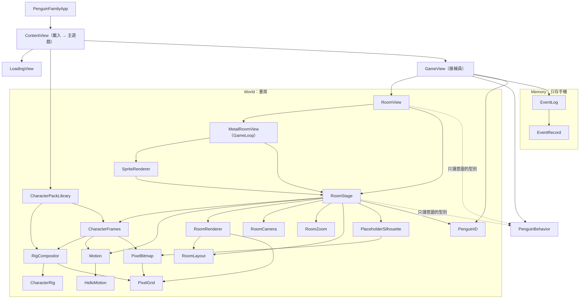
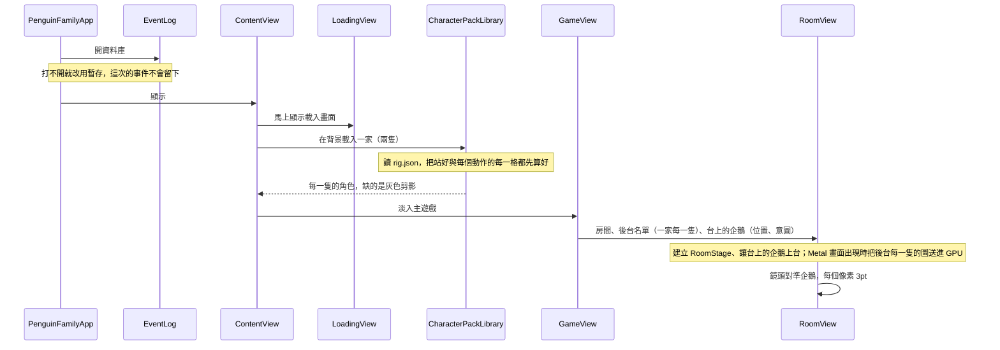

# 程式地圖

寫給作者與 Claude：快速看懂 App 目前長什麼樣子。只列**已經存在**的程式；規劃中的模組在最後一節。

- **為什麼這樣切**（模組邊界、設計原則、像素做法）看[架構](architecture.md)；這份只回答「有什麼、在哪裡、怎麼串起來」。
- **每個檔案的細節**寫在檔案開頭的 `///` 註解，這裡一個檔案只寫一句，避免兩邊寫同樣的事、改了一邊忘了另一邊。
- **保持同步**：`CodeMapTests` 會檢查每個 `.swift` 檔都列在這份文件裡、這裡列的檔案都存在；新增、刪除或改名檔案時，測試失敗就是提醒你回來更新。內容寫得對不對，還是靠人（作者 2026-11-16 決定）。
- 圖用 [Mermaid](https://docs.github.com/en/get-started/writing-on-github/working-with-advanced-formatting/creating-diagrams)：在 GitHub 上會畫成圖；在終端機裡看到的是原始文字。

最後更新：2026-11-17（舞台改成用身分加入、移除企鵝，第二隻先留在後台）。

## 一句話看懂

App 分三層，像 Vue 的「props 往下、events 往上」：

- **`Behavior`** 決定企鵝「想做什麼」，輸出意圖（待機、哈囉）。純 Swift，不碰畫面。
- **`World`** 把意圖畫出來，並把主人的手勢往上回報。只有這層碰畫面（SwiftUI 與 Metal）。
  - 畫面用 Metal 畫：`RoomStage` 決定每一格要畫什麼（純邏輯），`SpriteRenderer` 照清單把貼圖畫出來，`GameLoop` 跟著螢幕的節奏、有變化才畫。
- **`Memory`** 記下發生過的事，只存在手機上。
- **`GameView`** 是接線員：把三層接起來，本身幾乎沒有邏輯，像 Vue 的頁面元件。
- **`ContentView`** 先顯示載入畫面，在背景把角色準備好，再切到 `GameView`（見[架構的技術取捨](architecture.md#技術取捨)）。

## 檔案

### App 外殼

| 檔案 | 職責 |
|---|---|
| [PenguinFamilyApp.swift](../ios/PenguinFamily/PenguinFamilyApp.swift) | App 進入點：開事件紀錄的資料庫（打不開就改用暫存，企鵝照樣能用），放上 `ContentView`。 |
| [ContentView.swift](../ios/PenguinFamily/ContentView.swift) | 先顯示載入畫面，在背景做初始化（載入角色、預先算好每一格、打開事件紀錄），完成後淡入主遊戲。新增的初始化放在這裡的 `load()`。 |
| [LoadingView.swift](../ios/PenguinFamily/LoadingView.swift) | 載入畫面：和箱庭外面同一個底色，三個像素方塊輪流亮。暫時的樣子。 |
| [GameView.swift](../ios/PenguinFamily/GameView.swift) | 主遊戲的接線員：一家每一隻各有身分、狀態機與位置，決定誰在台上（目前只有第一隻）；主人點了哪一隻就交給那一隻，再把事件丟給事件紀錄在背景寫入。 |

### World：畫面

| 檔案 | 職責 |
|---|---|
| [CharacterPackLibrary.swift](../ios/PenguinFamily/World/CharacterPackLibrary.swift) | 列出 App 裡的角色包，依名稱載入一家兩隻（同時預先算好每一格）；壞掉的跳過，不夠的位置留給灰色剪影。不寫死角色 id。 |
| [PenguinID.swift](../ios/PenguinFamily/World/PenguinID.swift) | 一隻企鵝的身分：角色包 id，灰色剪影是 `placeholder-<第幾隻>`。舞台、點擊、動作播完、事件紀錄都用它認是哪一隻。 |

**`World/Pixel/`：企鵝怎麼畫**

| 檔案 | 職責 |
|---|---|
| [CharacterRig.swift](../ios/PenguinFamily/World/Pixel/CharacterRig.swift) | `rig.json` 的資料格式（調色盤、部件、轉軸、定稿正面圖）。 |
| [RigCompositor.swift](../ios/PenguinFamily/World/Pixel/RigCompositor.swift) | 部件合成：給一個姿勢（頭、手幾度、身體壓扁多少），拼出原始尺寸的一格小圖。照私有素材 repo 的 Python 規格，逐格相同。 |
| [Motion.swift](../ios/PenguinFamily/World/Pixel/Motion.swift) | 動作的通用格式：每秒幾格、共幾格、第幾格的姿勢；`Motion.all` 列出 App 會用到的所有動作。 |
| [HelloMotion.swift](../ios/PenguinFamily/World/Pixel/HelloMotion.swift) | 哈囉的時間軸：第幾格時頭、手各轉幾度。 |
| [CharacterFrames.swift](../ios/PenguinFamily/World/Pixel/CharacterFrames.swift) | 一隻角色預先算好的圖：站好一張，加上每個動作的每一格。載入角色時全部算好，播放時只取出來貼。 |
| [PixelGrid.swift](../ios/PenguinFamily/World/Pixel/PixelGrid.swift) | 像素格子：每格放一個調色盤代碼或透明。 |
| [PixelBitmap.swift](../ios/PenguinFamily/World/Pixel/PixelBitmap.swift) | 原始尺寸的 RGBA 位元組；直接送進 GPU 當貼圖，顏色不經過轉換。 |
| [PlaceholderSilhouette.swift](../ios/PenguinFamily/World/Pixel/PlaceholderSilhouette.swift) | 沒有角色包時的灰色占位剪影。 |

**`World/Room/`：箱庭怎麼畫**

| 檔案 | 職責 |
|---|---|
| [RoomLayout.swift](../ios/PenguinFamily/World/Room/RoomLayout.swift) | 房間的邏輯：幾格大、家具佔哪些格與多高、牆上有什麼、擺放檢查。也包含 `IsoProjection`：格子座標換算成等角的像素位置。 |
| [RoomRenderer.swift](../ios/PenguinFamily/World/Room/RoomRenderer.swift) | 畫牆、地板、窗戶與家具的色塊盒子；決定誰畫在前面。 |
| [RoomCamera.swift](../ios/PenguinFamily/World/Room/RoomCamera.swift) | 鏡頭的數學：畫面中央對著哪一點、不超出房間、慢慢靠近目標、對齊螢幕像素。 |
| [RoomZoom.swift](../ios/PenguinFamily/World/Room/RoomZoom.swift) | 縮放的數學：最大 3pt、最小房間左右塞滿畫面、放開後吸附、手指下那一點不動。 |
| [RoomStage.swift](../ios/PenguinFamily/World/Room/RoomStage.swift) | 箱庭的即時狀態：後台名單與台上的企鵝（`add`、`remove`）、鏡頭、縮放、每隻的位置與動作；每一格要畫哪些圖、點到哪一隻、要不要重畫、閒置後鏡頭回到中點。純邏輯。 |
| [RoomView.swift](../ios/PenguinFamily/World/Room/RoomView.swift) | 放上 Metal 畫面，把點擊、拖曳、捏合、意圖與「誰在台上」交給 `RoomStage`。 |

**`World/Render/`：用 Metal 畫出來**

| 檔案 | 職責 |
|---|---|
| [MetalRoomView.swift](../ios/PenguinFamily/World/Render/MetalRoomView.swift) | 把 Metal 畫面放進 SwiftUI；`GameLoop` 跟著螢幕更新（最高到手機支援的更新率），有變化才畫，沒事時暫停。 |
| [SpriteRenderer.swift](../ios/PenguinFamily/World/Render/SpriteRenderer.swift) | 載入時把所有圖送進 GPU；每一格照 `RoomStage` 的清單貼圖，對齊同一個像素格子、不平滑。shader 在同資料夾的 `Sprites.metal`。 |
| [PerfSignposts.swift](../ios/PenguinFamily/World/Render/PerfSignposts.swift) | 量效能用的標記（signpost）：遊戲迴圈每一格、算、畫、等畫布、點擊各花多久，在 Instruments 的 Points of Interest 看。 |

### Behavior：企鵝想做什麼

| 檔案 | 職責 |
|---|---|
| [PenguinBehavior.swift](../ios/PenguinFamily/Behavior/PenguinBehavior.swift) | 狀態機：待機 →（被點）→ 哈囉 →（播完）→ 待機；哈囉中再點會被忽略。只輸出意圖，不管動畫播多久。 |

### Memory：發生過什麼

| 檔案 | 職責 |
|---|---|
| [EventRecord.swift](../ios/PenguinFamily/Memory/EventRecord.swift) | 一筆事件的資料格式：什麼時候、什麼事、哪一隻。事件種類存字串，之後新增種類不用搬資料。 |
| [EventLog.swift](../ios/PenguinFamily/Memory/EventLog.swift) | 在背景寫入的事件紀錄（`ModelActor`）：開資料庫（關閉 iCloud 同步）、預熱、寫入事件、讀最近幾筆。一律用 `open(_:)` 在背景建立。 |

### 資源（不進 git）

`Resources/CharacterPacks.bundle/<角色>/rig.json`：角色包，由私有素材 repo 匯出。乾淨 clone 下來沒有，App 會顯示灰色剪影。

### 測試

| 檔案 | 測什麼 |
|---|---|
| [RigCompositorTests.swift](../ios/PenguinFamilyTests/RigCompositorTests.swift) | 合成規則，用手寫的 10×10 假角色，永遠會跑。 |
| [CharacterPackParityTests.swift](../ios/PenguinFamilyTests/CharacterPackParityTests.swift) | 和 Python 逐格相同；沒有角色包時自動跳過。 |
| [PenguinDisplayTests.swift](../ios/PenguinFamilyTests/PenguinDisplayTests.swift) | 哈囉時間軸、顏色轉換、找角色包、載入一家。 |
| [CharacterFramesTests.swift](../ios/PenguinFamilyTests/CharacterFramesTests.swift) | 預先算好的每一格和當場合成逐像素相同、超出範圍顯示站好、記憶體估算。 |
| [PenguinBehaviorTests.swift](../ios/PenguinFamilyTests/PenguinBehaviorTests.swift) | 狀態機的轉換。 |
| [EventLogTests.swift](../ios/PenguinFamilyTests/EventLogTests.swift) | 事件紀錄，每個測試用自己的記憶體資料庫；寫入不在主執行緒。 |
| [RoomTests.swift](../ios/PenguinFamilyTests/RoomTests.swift) | 房間擺放檢查、等角換算、背景與家具的畫法、前後順序。 |
| [RoomCameraTests.swift](../ios/PenguinFamilyTests/RoomCameraTests.swift) | 鏡頭範圍、對齊像素、慢慢靠近。 |
| [RoomZoomTests.swift](../ios/PenguinFamilyTests/RoomZoomTests.swift) | 縮放範圍、吸附、手指下那一點不動。 |
| [RoomStageTests.swift](../ios/PenguinFamilyTests/RoomStageTests.swift) | 要畫什麼與順序、點到哪一隻（重疊時前面優先）、拖曳、捏合、各自的動作、閒置後鏡頭回去、有變化才重畫、上台與下台、一開始只有第一隻在台上。 |
| [CodeMapTests.swift](../ios/PenguinFamilyTests/CodeMapTests.swift) | 這份文件和實際檔案一致。 |

Metal 實際畫出來的樣子與手感不在單元測試裡，用模擬器截圖與實機確認。

## 誰用誰

箭頭是「用到」。`Behavior` 與 `Memory` 不用到任何畫面的東西，所以可以單獨測試。



## 執行流程

只挑幾個代表情境；新增的功能如果走的是同一條路，就不另外畫。

### 打開 App



### 主人點一下企鵝

```mermaid
sequenceDiagram
    actor Owner as 主人
    participant RV as RoomView
    participant St as RoomStage
    participant GV as GameView
    participant Log as EventLog
    participant B as PenguinBehavior
    participant Loop as GameLoop

    Owner->>RV: 點一下
    RV->>St: 點到哪一隻？
    St-->>RV: 這一隻的 PenguinID（並重設閒置計時）
    RV->>GV: 這一隻被點了
    GV->>Log: 記下「主人點了這隻」
    GV->>B: 這一隻的狀態機收到「被點」
    B-->>GV: 意圖變成「哈囉」
    GV->>RV: 意圖：哈囉
    RV->>St: 開始播哈囉
    St->>Loop: 有變化，醒來
    loop 每一格（跟著螢幕更新）
        Loop->>St: 現在第幾格？要重畫嗎？
        Loop->>Loop: 有變才畫（哈囉每秒換 20 次圖）
    end
    St-->>Loop: 播完了
    Loop->>GV: 播完了（經過 RoomView）
    GV->>B: 收到「播完」
    B-->>GV: 意圖回到「待機」
    Note over Loop: 沒有東西在動，暫停省電
```

### 拖曳與捏合

都在 `RoomStage` 裡處理，不經過 `Behavior` 與 `Memory`。

```mermaid
sequenceDiagram
    actor Owner as 主人
    participant RV as RoomView
    participant St as RoomStage
    participant Loop as GameLoop

    Owner->>RV: 拖曳空地或雙指捏合
    RV->>St: 這一下移了多少、放大多少
    St->>St: 用 RoomCamera、RoomZoom 算新的鏡頭與縮放
    St->>Loop: 有變化，醒來重畫
    Owner->>RV: 放開
    RV->>St: 放開（縮放吸附到整數個螢幕像素）
    Note over Loop: 沒有東西在動，暫停，約定 5 秒後醒來
    loop 5 秒沒碰之後，每一格
        Loop->>St: 往企鵝靠近一步
    end
```

## 遊戲設計對到哪些程式

| [遊戲設計](product/game-design.md)的章節 | 程式 | 已做 | 還沒做 |
|---|---|---|---|
| 呈現（像素、等角） | `World/Pixel`、`World/Room`、`World/Render` | 正面圖、屋內箱庭、縮放、Metal 繪圖 | 斜向與走路（圖已在私有素材 repo，還沒匯出到 App） |
| 箱庭 | `World/Room` | 四件色塊家具、鏡頭 | 找路、庭院 |
| 手勢 | `RoomView`、`RoomStage` | 點一下、拖曳空地、捏合 | 拎起來、抱抱 |
| 行為與一天的節奏 | `Behavior` | 待機、哈囉 | 閒晃、睡覺、依權重反應、日夜 |
| 兩隻 | `RoomStage`、`GameView` | 一家兩隻各有身分、狀態機與事件紀錄；舞台可加入、移除；寫移動的期間只有第一隻在台上（第二隻是灰色剪影，留在後台） | 第二隻上台（A1 第 8 項）、第二隻的美術與個性、一起行動、鬥嘴 |
| 不在時的痕跡 | `Memory` | 記下點擊 | 補算小事、回來看得到 |
| 台詞 | `Soul`（未建立） | － | 全部 |
| 觸覺 | `Feel`（未建立） | － | 全部 |

## 規劃中、還沒建立

位置與分工見[架構](architecture.md)的目錄圖。

- `Soul/`：角色聖經、台詞選擇、`DialogueEngine`（A1 第 15 項）。
- `Feel/`：觸覺與音效（A1 第 12 項）。
- `Activity/`、`PenguinFamilyWidget/`：步數與小工具（A3）。
- `backend/`：聊天的薄後端（B1）。
