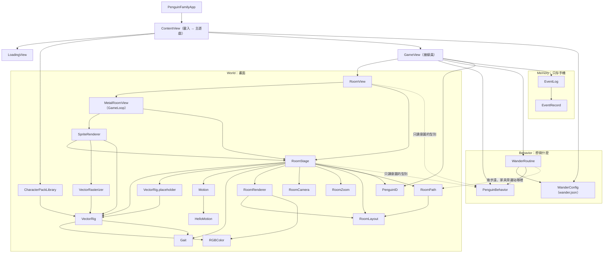
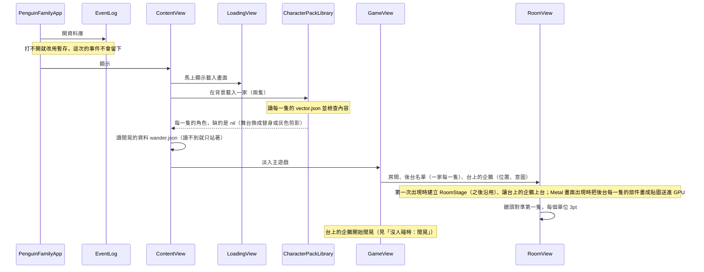

# 程式地圖

寫給作者與 Claude：快速看懂 App 目前長什麼樣子。只列**已經存在**的程式；規劃中的模組在最後一節。

- **為什麼這樣切**（模組邊界、設計原則、向量做法）看[架構](architecture.md)；這份只回答「有什麼、在哪裡、怎麼串起來」。
- **每個檔案的細節**寫在檔案開頭的 `///` 註解，這裡一個檔案只寫一句，避免兩邊寫同樣的事、改了一邊忘了另一邊。
- **保持同步**：`CodeMapTests` 會檢查每個 `.swift` 檔都列在這份文件裡、這裡列的檔案都存在；新增、刪除或改名檔案時，測試失敗就是提醒你回來更新。內容寫得對不對，還是靠人（作者 2026-11-16 決定）。
- 圖用 [Mermaid](https://docs.github.com/en/get-started/writing-on-github/working-with-advanced-formatting/creating-diagrams)：在 GitHub 上會畫成圖；在終端機裡看到的是原始文字。

最後更新：2026-11-19（A1 第 12 項：第二隻回到畫面、兩隻互相讓路、走去黏著另一隻、鏡頭優先看第一隻）。

## 一句話看懂

App 分三層，像 Vue 的「props 往下、events 往上」：

- **`Behavior`** 決定企鵝「想做什麼」，輸出意圖（待機、哈囉、走去某一格、站著幾秒）；沒人碰時由閒晃照資料挑下一步。純 Swift，不碰畫面。
- **`World`** 把意圖畫出來，並把主人的手勢往上回報。只有這層碰畫面（SwiftUI 與 Metal）。
  - 畫面用 Metal 畫：`RoomStage` 決定每一格要畫什麼（純邏輯），`SpriteRenderer` 照清單把貼圖畫出來，`GameLoop` 跟著螢幕的節奏、有變化才畫。
- **`Memory`** 記下發生過的事，只存在手機上。
- **`GameView`** 是接線員：把三層接起來，本身幾乎沒有邏輯，像 Vue 的頁面元件。
- **`ContentView`** 先顯示載入畫面，在背景把角色準備好，再切到 `GameView`（見[架構的技術取捨](architecture.md#技術取捨)）。

## 檔案

### App 外殼

| 檔案 | 職責 |
|---|---|
| [PenguinFamilyApp.swift](../ios/PenguinFamily/PenguinFamilyApp.swift) | App 進入點：開事件紀錄的資料庫（打不開就改用暫存，企鵝照樣能用），放上 `ContentView`。 |
| [ContentView.swift](../ios/PenguinFamily/ContentView.swift) | 先顯示載入畫面，在背景做初始化（載入角色、打開事件紀錄、讀閒晃的資料），完成後淡入主遊戲。新增的初始化放在這裡的 `load()`。 |
| [LoadingView.swift](../ios/PenguinFamily/LoadingView.swift) | 載入畫面：和箱庭外面同一個底色，三個小方塊輪流亮。暫時的樣子。 |
| [GameView.swift](../ios/PenguinFamily/GameView.swift) | 主遊戲的接線員：一家每一隻各有身分、狀態機、閒晃與位置，決定誰在台上（一家兩隻）；主人點了哪一隻就交給那一隻，再把事件丟給事件紀錄在背景寫入；走到時記下新位置；台上的企鵝一回到待機，就問牠的閒晃下一步，並告訴閒晃別隻在哪一格。 |

### World：畫面

| 檔案 | 職責 |
|---|---|
| [CharacterPackLibrary.swift](../ios/PenguinFamily/World/CharacterPackLibrary.swift) | 列出 App 裡的角色包（有 `vector.json` 的資料夾），依名稱載入一家兩隻（最前面的是第一隻）；壞掉的跳過，不夠的位置留給替身或灰色剪影。不寫死角色 id。 |
| [PenguinID.swift](../ios/PenguinFamily/World/PenguinID.swift) | 一隻企鵝的身分：角色包 id，沒有角色包的是 `placeholder-<第幾隻>`。舞台、點擊、動作播完、事件紀錄都用它認是哪一隻。 |
| [RGBColor.swift](../ios/PenguinFamily/World/RGBColor.swift) | 不透明的 sRGB 顏色，解析 `#RRGGBB`；角色包的顏色層、箱庭的色塊都用它。 |

**`World/Motion/`：企鵝怎麼動（數字不分角色）**

| 檔案 | 職責 |
|---|---|
| [Motion.swift](../ios/PenguinFamily/World/Motion/Motion.swift) | 正面的姿勢 `RigPose`（頭、手幾度、身體壓扁多少），與正面動作的格式：播多久、第幾秒是什麼姿勢。 |
| [HelloMotion.swift](../ios/PenguinFamily/World/Motion/HelloMotion.swift) | 哈囉的時間軸：第幾秒時頭、手各轉幾度、身體壓扁多少。 |
| [Gait.swift](../ios/PenguinFamily/World/Motion/Gait.swift) | 面向（正面與斜向四個方向）；步態（慢走、小跑）的數字、速度，與第幾秒的斜向姿勢 `VectorWalkPose`。 |

**`World/Vector/`：企鵝的造型（ADR 0007）**

| 檔案 | 職責 |
|---|---|
| [VectorRig.swift](../ios/PenguinFamily/World/Vector/VectorRig.swift) | `vector.json` 的資料格式與檢查（部件的形狀、轉軸、顏色層、外框；斜向的走法；右邊翻轉左邊）；`Affine2D` 矩陣；某一格的樣子 `VectorPose`（正面的姿勢，或斜向的方向與走路的姿勢）換成每個部件的矩陣。算式和私有素材 repo 的 `vector.js` 逐格相同。 |
| [VectorRasterizer.swift](../ios/PenguinFamily/World/Vector/VectorRasterizer.swift) | 載入時用 Core Graphics 把每個畫好的方向的每個部件畫成兩張貼圖（外框、顏色），解析度照抱抱近景的倍率準備（螢幕倍率最多算到 2）；裁切每一組取聯集、組與組取交集；不用畫就能算出貼圖佔多少記憶體。 |
| [PlaceholderRig.swift](../ios/PenguinFamily/World/Vector/PlaceholderRig.swift) | 沒有角色包時的造型：替身（`graySilhouette()`，借別隻的形狀整隻塗灰，會斜著走）；一家都沒有角色包時的灰色剪影（`VectorRig.placeholder`：只有正面，手藏在身體裡，哈囉時轉出來揮）。 |

**`World/Room/`：箱庭怎麼畫**

| 檔案 | 職責 |
|---|---|
| [RoomPath.swift](../ios/PenguinFamily/World/Room/RoomPath.swift) | 找路：哪些格子站得上去、沿格線一格一格走、繞過家具（需要時也避開別隻站的格子）；先挑最短、再挑轉彎最少，拆成一段段直線（每段對到斜向的一張圖）。閒晃用的：走到每一格要幾步、家具與窗戶旁邊站哪一格、某一格（別隻）四周站哪一格、面向哪裡（`RoomSpot`）。 |
| [RoomLayout.swift](../ios/PenguinFamily/World/Room/RoomLayout.swift) | 房間的邏輯：幾格大、家具佔哪些格與多高、牆上有什麼、擺放檢查。也包含 `IsoProjection`：格子座標換算成等角的位置（單位，不取整數）。 |
| [RoomRenderer.swift](../ios/PenguinFamily/World/Room/RoomRenderer.swift) | 把牆、地板、窗戶與家具的色塊盒子做成凸多邊形（家具外面一圈外框）；決定誰畫在前面。 |
| [RoomCamera.swift](../ios/PenguinFamily/World/Room/RoomCamera.swift) | 鏡頭的數學：畫面中央對著哪一點、不超出房間、慢慢靠近目標。 |
| [RoomZoom.swift](../ios/PenguinFamily/World/Room/RoomZoom.swift) | 縮放的數學：最大 3pt、最小房間左右塞滿畫面、放開後停在那個倍率、手指下那一點不動。 |
| [RoomStage.swift](../ios/PenguinFamily/World/Room/RoomStage.swift) | 箱庭的即時狀態：後台名單與台上的企鵝（`add`、`remove`）、鏡頭、縮放、每隻的位置、面向與動作；走路（找路、照步態速度沿路走、位置每一格都前進、走到回報）；站著（轉向、站滿回報；畫面不動時讓遊戲迴圈暫停，站滿再醒來）；同樣的意圖再要一次時看編號重新開始；走路被打斷時停在兩格之間，再走時從那裡沿格線接著走；企鵝每一格照當下的方向與姿勢；兩隻互相讓路（下一格被佔住就停下來等，等不到再繞路，繞不過去就放棄）；沒有角色包的那隻換成替身；每一格要畫哪些東西（箱庭的多邊形、企鵝）（企鵝在家具旁邊時依格子關係排前後）、點到哪一隻、要不要重畫、閒置後鏡頭回到第一隻。純邏輯。 |
| [RoomView.swift](../ios/PenguinFamily/World/Room/RoomView.swift) | 放上 Metal 畫面，把點擊、拖曳、捏合、意圖（含編號）與「誰在台上」交給 `RoomStage`；舞台在第一次出現時才建，之後沿用。 |

**`World/Render/`：用 Metal 畫出來**

| 檔案 | 職責 |
|---|---|
| [MetalRoomView.swift](../ios/PenguinFamily/World/Render/MetalRoomView.swift) | 把 Metal 畫面放進 SwiftUI；`GameLoop` 跟著螢幕更新（最高到手機支援的更新率），有變化才畫，沒事時暫停；把動作播完、走到回報出去。 |
| [SpriteRenderer.swift](../ios/PenguinFamily/World/Render/SpriteRenderer.swift) | 載入時把箱庭的多邊形切成三角形、企鵝的部件畫成貼圖（含 mipmap）；每一格照 `RoomStage` 的清單畫：多邊形、企鵝（先畫整隻的外框再畫顏色，部件依姿勢轉動；右前、右後翻轉左邊的貼圖）。4 倍多重取樣抗鋸齒。shader 在同資料夾的 `Sprites.metal`。 |
| [PerfSignposts.swift](../ios/PenguinFamily/World/Render/PerfSignposts.swift) | 量效能用的標記（signpost）：遊戲迴圈每一格、算、畫、等畫布、點擊各花多久，在 Instruments 的 Points of Interest 看。 |

### Behavior：企鵝想做什麼

| 檔案 | 職責 |
|---|---|
| [PenguinBehavior.swift](../ios/PenguinFamily/Behavior/PenguinBehavior.swift) | 狀態機：待機 →（被點）→ 哈囉 →（播完）→ 待機；待機 →（要牠走去某一格）→ 走路 →（走到）→ 待機；待機 →（要牠站幾秒）→ 站著 →（站滿）→ 待機，站著時被點就哈囉；走路中被點當場停下哈囉，記下那段路，播完接著走。哈囉中再點會被忽略。意圖每換一次編號加一。只輸出意圖，不管動畫播多久、怎麼走過去。 |
| [WanderConfig.swift](../ios/PenguinFamily/Behavior/WanderConfig.swift) | 閒晃的資料格式與檢查（每種活動的權重、冷卻、待多久；慢走與小跑的比例；走幾步停一下；東張西望看哪些方向），讀 App 裡的 `wander.json`。 |
| [WanderRoutine.swift](../ios/PenguinFamily/Behavior/WanderRoutine.swift) | 閒晃：依權重挑活動、冷卻中的先不挑，拆成「走去某一格」「站著幾秒」一步步交給狀態機（走到家具旁邊面向它、隨便走走、發呆、東張西望、走去黏著另一隻，路長時走幾步停一下）；別隻的格子不當目的地。亂數、時間與別隻在哪由外面給。 |

### Memory：發生過什麼

| 檔案 | 職責 |
|---|---|
| [EventRecord.swift](../ios/PenguinFamily/Memory/EventRecord.swift) | 一筆事件的資料格式：什麼時候、什麼事、哪一隻。事件種類存字串，之後新增種類不用搬資料。 |
| [EventLog.swift](../ios/PenguinFamily/Memory/EventLog.swift) | 在背景寫入的事件紀錄（`ModelActor`）：開資料庫（關閉 iCloud 同步）、預熱、寫入事件、讀最近幾筆。一律用 `open(_:)` 在背景建立。 |

### 資源

- `Resources/wander.json`（進 git）：閒晃的資料，兩隻共用，格式寫在 `WanderConfig` 的開頭。
- `Resources/CharacterPacks.bundle/<角色>/vector.json`（不進 git）：角色包，由私有素材 repo 匯出。乾淨 clone 下來沒有，App 會顯示灰色剪影。

### 測試

| 檔案 | 測什麼 |
|---|---|
| [VectorPackParityTests.swift](../ios/PenguinFamilyTests/VectorPackParityTests.swift) | 拿真實角色包比對：哈囉每一格、斜向四個方向每個步態抽樣的姿勢與每個部件的矩陣和 `vector.js` 相同；沒有角色包時自動跳過。 |
| [PenguinDisplayTests.swift](../ios/PenguinFamilyTests/PenguinDisplayTests.swift) | 哈囉時間軸、顏色、找角色包、載入一家、灰色剪影（只有正面、手藏在身體裡）。 |
| [PenguinBehaviorTests.swift](../ios/PenguinFamilyTests/PenguinBehaviorTests.swift) | 狀態機的轉換（含走路中被點：哈囉完接著走）、意圖的編號。 |
| [WanderTests.swift](../ios/PenguinFamilyTests/WanderTests.swift) | 閒晃：`wander.json` 讀得進來、不合理的數字擋下來；依權重挑、冷卻、走去家具旁邊面向它、隨便走走的距離、走幾步停一下、東張西望不連續看同一邊、發呆的方向、走去黏著另一隻、別隻的格子不當目的地也不在那裡停。用固定種子的亂數。 |
| [EventLogTests.swift](../ios/PenguinFamilyTests/EventLogTests.swift) | 事件紀錄，每個測試用自己的記憶體資料庫；寫入不在主執行緒。 |
| [RoomTests.swift](../ios/PenguinFamilyTests/RoomTests.swift) | 房間擺放檢查、等角換算、背景與家具的多邊形（凸的、外框往外推）、前後順序、灰色剪影站在腳底上。 |
| [VectorRigTests.swift](../ios/PenguinFamilyTests/VectorRigTests.swift) | 向量角色包的讀檔與檢查、正面的姿勢連動（轉軸不動、壓扁時腳底不動）、斜向（站著不動、上半身以腳底傾斜、手往外張、翻轉以腳底為軸、步態每一格只差一點點）、部件畫成貼圖的顏色、外框與裁切、替身（形狀不變、整隻塗灰）、角色包一起載入，用手寫的 20×20 假角色，永遠會跑。 |
| [VectorMemoryBudgetTests.swift](../ios/PenguinFamilyTests/VectorMemoryBudgetTests.swift) | 記憶體預算：一家的向量貼圖（缺角色包的那隻算替身）在螢幕 3 倍的手機上（含 mipmap）不能超過 50MB，用真實角色包算；超過就失敗，先和作者討論怎麼省。沒有角色包時自動跳過。貼圖最多照 2 倍準備。 |
| [RoomPathTests.swift](../ios/PenguinFamilyTests/RoomPathTests.swift) | 站得上去的格子、每一段的方向、直線、轉彎最少、繞過沙發、每次同一條路、到不了的情況、屋內每塊地板都走得到、避開別隻的格子；幾步遠和找路相同、家具與窗戶旁邊站哪裡、別隻四周站哪裡。 |
| [RoomCameraTests.swift](../ios/PenguinFamilyTests/RoomCameraTests.swift) | 鏡頭範圍、左上角不對齊像素、慢慢靠近。 |
| [RoomZoomTests.swift](../ios/PenguinFamilyTests/RoomZoomTests.swift) | 縮放範圍、不吸附、手指下那一點不動。 |
| [RoomStageTests.swift](../ios/PenguinFamilyTests/RoomStageTests.swift) | 要畫什麼與順序、點到哪一隻（重疊時前面優先）、拖曳、捏合、各自的動作、閒置後鏡頭回到第一隻、有變化才重畫、上台與下台、一開始兩隻都在台上、缺角色包的那隻用替身、兩隻互相讓路（繞開、先等再繞路、放棄、迎面走過、照 `GameView` 的接線一起閒晃 5 分鐘不疊在一起）、重新建立 `RoomView` 不會重建舞台、走路（姿勢每一格照時間算）、站著（轉向、站滿回報、不讓遊戲迴圈一直跑、被哈囉打斷、同樣的意圖看編號重新開始）、走路被打斷（停在原地、接著走不跳、回頭比較近時回頭、到不了停在比較近的一格）、企鵝在家具旁邊時的前後、正面的動作每一格照時間轉、沒有斜向的造型（灰色剪影）走路時面向鏡頭。 |
| [CodeMapTests.swift](../ios/PenguinFamilyTests/CodeMapTests.swift) | 這份文件和實際檔案一致。 |

Metal 實際畫出來的樣子與手感不在單元測試裡，用模擬器截圖與實機確認。

## 誰用誰

箭頭是「用到」。`Behavior` 與 `Memory` 不用到任何畫面的東西，所以可以單獨測試。



## 執行流程

只挑幾個代表情境；新增的功能如果走的是同一條路，就不另外畫。

### 打開 App



### 主人點一下企鵝

```mermaid
sequenceDiagram
    actor Owner as 主人
    participant RV as RoomView
    participant St as RoomStage
    participant GV as GameView
    participant Log as EventLog
    participant B as PenguinBehavior
    participant Loop as GameLoop

    Owner->>RV: 點一下
    RV->>St: 點到哪一隻？
    St-->>RV: 這一隻的 PenguinID（並重設閒置計時）
    RV->>GV: 這一隻被點了
    GV->>Log: 記下「主人點了這隻」
    GV->>B: 這一隻的狀態機收到「被點」
    B-->>GV: 意圖變成「哈囉」
    GV->>RV: 意圖：哈囉
    RV->>St: 開始播哈囉
    St->>Loop: 有變化，醒來
    loop 每一格（跟著螢幕更新）
        Loop->>St: 現在第幾秒？要重畫嗎？
        Loop->>Loop: 有變才畫（哈囉播放中每一格照時間轉動部件）
    end
    St-->>Loop: 播完了
    Loop->>GV: 播完了（經過 RoomView）
    GV->>B: 收到「播完」
    B-->>GV: 意圖回到「待機」（走路被打斷的話，接著走那段路）
    Note over GV: 回到待機就問閒晃下一步（見下一節）
```

### 沒人碰時：閒晃

企鵝一回到待機（打開 App、走到、站滿、哈囉播完），`GameView` 就問牠的閒晃下一步。站著時畫面不動，遊戲迴圈暫停到站滿再醒來。

```mermaid
sequenceDiagram
    participant GV as GameView
    participant W as WanderRoutine
    participant B as PenguinBehavior
    participant St as RoomStage
    participant Loop as GameLoop

    GV->>W: 下一步？（站在哪一格、別隻在哪一格、現在幾秒）
    Note over W: 這次活動的步驟用完了：依權重挑一種（冷卻中的先不挑），<br/>例如「走去窗邊」：走過去（路長時走幾步停一下）→ 面向窗戶站 8～15 秒
    W-->>GV: 走去 (7, 0)，慢走
    GV->>B: 要牠走去 (7, 0)
    B-->>GV: 意圖：走路（編號加一）
    GV->>St: 意圖：走路（經過 RoomView）
    loop 每一格
        Loop->>St: 沿路走
    end
    St-->>GV: 走到了（經過 GameLoop、RoomView）
    GV->>B: 走到 → 待機
    GV->>W: 下一步？
    W-->>GV: 面向右後（窗戶）站 10 秒
    GV->>B: 要牠站 10 秒
    GV->>St: 意圖：站著
    St->>St: 轉向右後
    Note over Loop: 畫面不動，暫停，約定 10 秒後醒來
    St-->>GV: 站滿了
    GV->>B: 播完 → 待機
    GV->>W: 下一步？（這次活動做完了，挑新的）
```

主人在牠站著時點牠，狀態機改成哈囉；哈囉播完回到待機，閒晃接著做剩下的步驟。走路中點牠，舞台停在當下的位置（可能在兩格之間）、轉正面哈囉；播完狀態機接回同一段路，舞台從停的地方接著走，走到後閒晃再接著做。

### 拖曳與捏合

都在 `RoomStage` 裡處理，不經過 `Behavior` 與 `Memory`。

```mermaid
sequenceDiagram
    actor Owner as 主人
    participant RV as RoomView
    participant St as RoomStage
    participant Loop as GameLoop

    Owner->>RV: 拖曳空地或雙指捏合
    RV->>St: 這一下移了多少、放大多少
    St->>St: 用 RoomCamera、RoomZoom 算新的鏡頭與縮放
    St->>Loop: 有變化，醒來重畫
    Owner->>RV: 放開
    RV->>St: 放開（縮放停在那個倍率）
    Note over Loop: 沒有東西在動，暫停，約定 5 秒後醒來
    loop 5 秒沒碰之後，每一格
        Loop->>St: 往第一隻靠近一步
    end
```

## 遊戲設計對到哪些程式

| [遊戲設計](product/game-design.md)的章節 | 程式 | 已做 | 還沒做 |
|---|---|---|---|
| 呈現（平面向量、等角） | `World/Vector`、`World/Motion`、`World/Room`、`World/Render` | 正面與哈囉、斜向四個方向、慢走與小跑、屋內箱庭、縮放、Metal 繪圖 | 其他動作（打瞌睡、被拎著等） |
| 箱庭 | `World/Room` | 四件色塊家具、鏡頭、找路（沿格線、繞過家具） | 庭院 |
| 手勢 | `RoomView`、`RoomStage` | 點一下（站著、走路中都會哈囉）、拖曳空地、捏合 | 拎起來、抱抱 |
| 行為與一天的節奏 | `Behavior` | 待機、哈囉、閒晃（走向家具與窗邊、隨便走走、發呆、東張西望、走去黏著另一隻、走幾步停一下；權重與冷卻在 `wander.json`） | 睡覺、依權重反應、日夜 |
| 兩隻 | `RoomStage`、`GameView` | 一家兩隻各有身分、狀態機與事件紀錄，都在台上閒晃；互相讓路；第二隻的美術好之前是借第一隻形狀塗灰的替身；鏡頭優先看第一隻 | 第二隻的美術與個性、看向對方、一起行動、鬥嘴 |
| 不在時的痕跡 | `Memory` | 記下點擊 | 補算小事、回來看得到 |
| 台詞 | `Soul`（未建立） | － | 全部 |
| 觸覺 | `Feel`（未建立） | － | 全部 |

## 規劃中、還沒建立

位置與分工見[架構](architecture.md)的目錄圖。

- `Soul/`：角色聖經、台詞選擇、`DialogueEngine`（A1 第 19 項）。
- `Feel/`：觸覺與音效（A1 第 16 項）。
- `Activity/`、`PenguinFamilyWidget/`：步數與小工具（A3）。
- `backend/`：聊天的薄後端（B1）。
